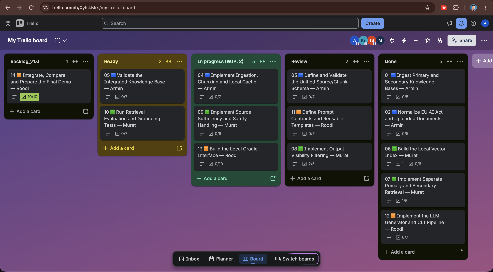
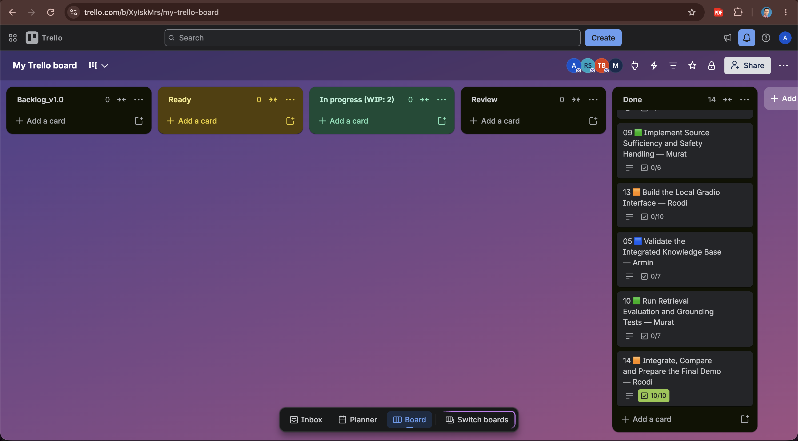
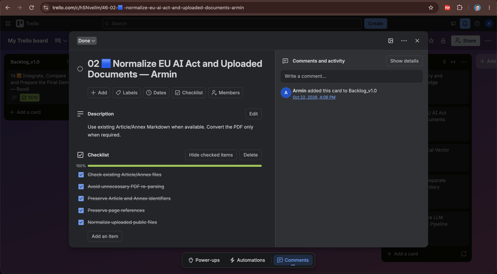
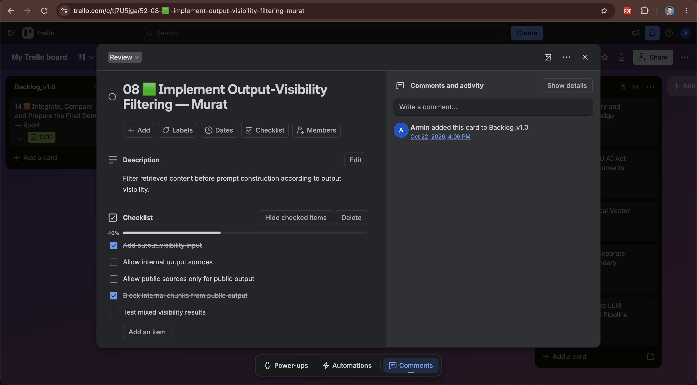
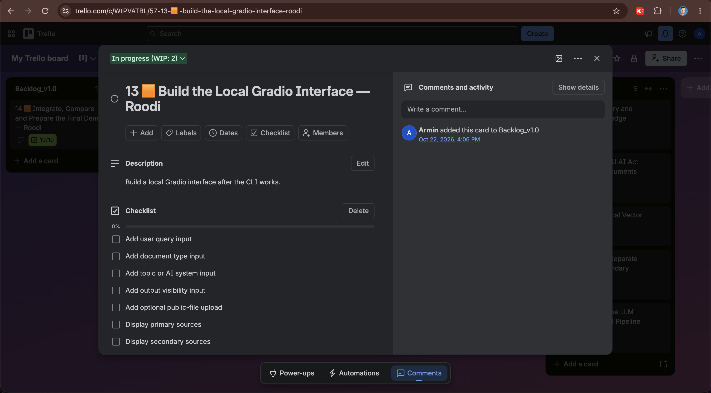

# AI Governance Copilot

A short-course Python RAG prototype that helps an AI Governance / Risk analyst identify potential documentation gaps in a fictional organisation's supplied AI governance knowledge base and generate source-grounded draft documents and communications for human review.

## Links

- [Live Demo](https://project2-ai-governance-copilot.onrender.com/)
- [GitHub Repository](https://github.com/Roodabeh2018/Project2_AI_governance_Copilot)
- Project Board: Trello workflow evidence is included below in [`docs/screenshots/`](docs/screenshots/).

The live demo is deployed from the reviewed and merged `main` branch. Runtime uploads and generated outputs are local to the running service and are not committed to the repository.

## Project board evidence

### Trello board overview



### Workflow and task ownership









## MVP
- Load the synthetic primary company documents and the official 144-page EU AI Act PDF.
- Accept optional user-uploaded internal documents into `primary` and public/reference documents into `secondary`.
- Retrieve source passages with metadata.
- Keep primary and secondary retrieval results separate and apply visibility filtering before prompt construction.
- Produce a cautious potential-gap summary.
- Generate at least one governance document draft (recommended: AI System Monitoring Plan).
- Generate an internal update using a second prompt template.
- Optional if time allows: a public LinkedIn-style post based only on public-tagged sources.
- Save Markdown drafts under `outputs/`.

## Data
All company documents are synthetic. Do not add confidential real company data. The official EU AI Act PDF is the baseline regulatory source for the MVP. Supporting notes are not authoritative legal text.

## Setup outline
1. Create/activate a Python virtual environment.
2. Install the packages chosen by the team and record them in `requirements.txt`.
3. Copy `.env.example` to `.env` and add API keys locally if needed. Never commit `.env`.
4. Place company documents in `knowledge_base/primary/`.
5. Keep the official EU AI Act PDF in `knowledge_base/secondary/eu_ai_act/`.
6. Place optional user-uploaded public/reference documents in `knowledge_base/secondary/`.
   Article/Annex Markdown replaces the official PDF only when
   `knowledge_base/secondary/eu_ai_act/.replace_official_pdf` exists; ordinary
   uploads remain additive.
7. Run the ingestion/indexing flow, then generate a draft using the CLI.
   The index is stored in `cache/vectors.npy` with its vector-to-chunk mapping
   in `cache/metadata.json`; reload it with `load_index(CACHE_DIR)` from
   `src.indexing`. Retrieval independently ranks Primary and Secondary evidence
   and saves the result, including relevance scores and citations, to
   `cache/retrieved_context.json`.
8. Review citations, placeholders and output status before presenting.

## Suggested demo
Ask what evidence exists for monitoring of a fictional AI system; show retrieved passages and a potential gap; generate an AI System Monitoring Plan with placeholders for unknowns; generate a short internal update. Explain that the result is a draft and not a compliance determination.

## How to run (Windows PowerShell, tested 23–24 Oct 2026)

Run every command from the project folder (the one that contains `src/`).

> **Status of this guide:** all steps work on the current `main` (RAG pipeline with the vector index, Color C checks, Gradio UI and Render deployment are merged).

### 1. Environment
```
conda activate bootcamp-env
pip install -r requirements.txt
pip install -U pypdf            # pypdf 6.x is needed for clean EU AI Act text
copy .env.example .env          # then add OPENAI_API_KEY in .env — never commit .env
```
`LLM_PROVIDER=mock` gives free canned answers instead of calling the LLM (for tests and rehearsals); `LLM_PROVIDER=openai` (the default in `.env.example`) uses `MODEL_NAME` (default `gpt-4o-mini`).
Note: `mock` only replaces **generation**. Retrieval with the vector index still calls the **embedding API** for the query. A run is fully offline only with `--fixture` **and** `LLM_PROVIDER=mock`.

### 2. Check the knowledge base (Color A)
```
python -m src.kb_validation
```
Prints the number of Primary/Secondary documents and chunks, or a clear error.

### 3. Build the chunk cache and vector index (Color A + B)
Needs `OPENAI_API_KEY` (embeddings, paid; a few cents). Run once, and again after adding documents:
```
python -m src.build_index
```
The same as the longer one-liner:
```
python -c "from src.config import PRIMARY_DIR, SECONDARY_DIR, CACHE_DIR; from src.chunking import rebuild_cache; from src.indexing import build_index; build_index(rebuild_cache(PRIMARY_DIR, SECONDARY_DIR, CACHE_DIR), CACHE_DIR)"
```
Writes `cache/chunks.jsonl`, `cache/vectors.npy` and `cache/metadata.json` (git-ignored).

### 4. Run the tests (offline, no API cost)
```
python -m pytest -q
```
Expected on `main` `913961c` (24 Oct 2026): **143 passed** with pypdf 6.21. Known issue: with pypdf 6.10 one ingestion test fails (`test_loads_current_primary_and_official_secondary_baseline`, exact phrase “Artificial Intelligence Act” in the extracted PDF text); owned by Color A, see `docs/test_plan.md`.

### 5. Generate drafts from the command line (Color C)
```
# governance document (interactive review: [a]pprove / [f]eedback / [r]eject / [s]ave as draft)
python -m src.pipeline --type governance_document --document "AI System Monitoring Plan" --topic "monitoring and human oversight"

# internal update with findings for the gap register
python -m src.pipeline --type internal_update --topic "monitoring and human oversight"

# public output: only public-tagged sources are used
python -m src.pipeline --type governance_document --visibility public --no-review

# unknown AI system → "insufficient source"
python -m src.pipeline --type governance_document --system AI-99 --no-review

# fully offline: shared fixture instead of retrieval AND mock generation (no API calls)
$env:LLM_PROVIDER="mock"
python -m src.pipeline --type governance_document --fixture tests/fixtures/sample_retrieved_context.json --no-review
Remove-Item Env:LLM_PROVIDER    # back to the value in .env
```
Drafts are saved under `outputs/governance_documents/` and `outputs/internal_updates/`, always marked `Draft — human review required`.

### 6. Local Gradio app
```
python -m src.app
```
Open http://127.0.0.1:7860. Tabs:
1. **Generate & review**: generate a draft, inspect the retrieved sources, approve / reject / save as draft.
2. **Upload documents**: internal documents → Primary, public regulations → Secondary; the index is rebuilt, and complete gap-register items are set to `re_check` after a new regulation.
3. **Gap register**: status per requirement (open / complete / re_check), with approver, date and source references. It only changes after a human approves an internal update, and every finding is validated first (known requirement ID, valid status, supplied sources).

### Evidence for the course requirements
- `docs/uniqueness_comparison.md`: Copilot vs. generic ChatGPT (M7)
- `docs/public_leakage_test.md`: public output never uses internal sources
- `docs/test_plan.md`: test plan with automated test mapping
- `docs/demo_script.md`: presentation and demo script
- `docs/prompt_iteration_log.md`: prompt iterations and prompting strategies
- `docs/agent_usage.md`: how `AGENTS.md` guided the work (card, Must ID, rule, change, test, commit)
- `docs/evidence/`: saved real-LLM outputs used as evidence
- `project_structure.md` §7–7a: team split along the RAG pipeline and WBS → Trello card → Must ID

## Deploy on Render (free web service)

The app runs as one Render **Web Service** built from `main`. Every push to `main` redeploys it, so only reviewed and merged code goes live.

| Setting | Value |
|---|---|
| Runtime | Python 3 |
| Build command | `pip install -r requirements.txt && python -m src.build_index` |
| Start command | `python -m src.app` |
| Instance type | Free |

**Environment variables** (Render → Environment; never in the repo):

| Key | Value |
|---|---|
| `OPENAI_API_KEY` | your key |
| `MODEL_NAME` | `gpt-4o-mini` |
| `LLM_PROVIDER` | `openai` |
| `PYTHON_VERSION` | `3.12.7` |
| `APP_USERNAME`, `APP_PASSWORD` | a login for the public link, so strangers cannot spend the API budget |

`src/app.py` listens on `0.0.0.0` and Render's `PORT` when `PORT` is set, and on `127.0.0.1:7860` locally. The index is built during the build step, because `cache/` is git-ignored.

**Free-plan limits:** the service sleeps after 15 minutes without visitors (open the link a few minutes before the demo). Files written at runtime (`outputs/`, `data/gap_register.json`, uploads, the rebuilt index) are lost on every restart or redeploy. **Plan B:** run locally with `python -m src.app`.
